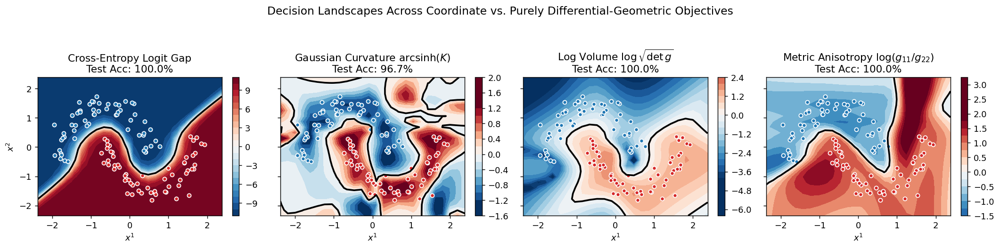
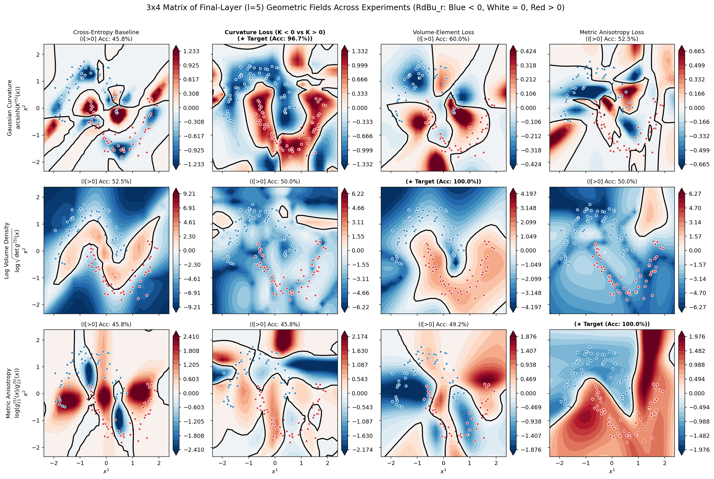
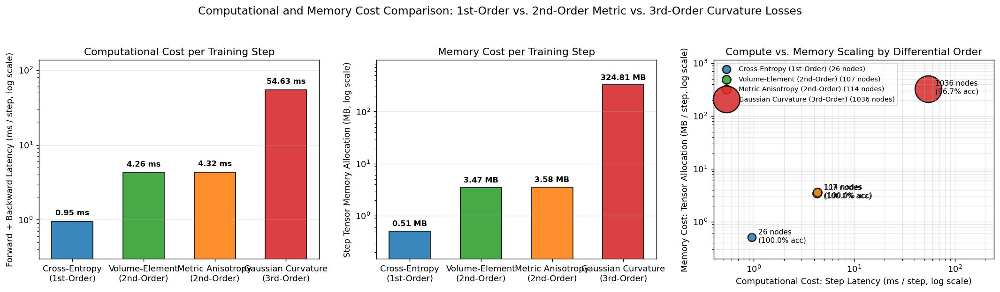

# Differential Geometry of Deep Learning: Parameter & Representation Manifolds

This project investigates the differential geometric interplay between two fundamental manifolds in machine learning using a **`[2 -> 5 -> 10 -> 15 -> 10 -> 2]` Multi-Layer Perceptron** ($P = 422$ parameters) on the 2D `sklearn.datasets.make_moons` benchmark:

1. **The Parameter Manifold ($\Theta \subset \mathbb{R}^{422}$)**: Endowed with the $422 \times 422$ Fisher Information Metric $F_{\mu\nu}(\theta)$ and Generalized Gauss-Newton pullback metric $G^\Theta_{\mu\nu}(\theta)$.
2. **The Data / Representation Manifolds ($\{\mathcal{M}_\ell\}_{\ell=0}^5$)**: The sequence of immersed 2D surfaces $\Phi^{(\ell)}_\theta(\mathbb{R}^2) \subset \mathbb{R}^{d_\ell}$ endowed with layerwise $2 \times 2$ pullback metric tensors $g^{(\ell)}_{ij}(x; \theta)$, Riemannian volume forms $\sqrt{\det g^{(\ell)}(x; \theta)}$, Levi-Civita Christoffel symbols $\Gamma^{(\ell)k}_{ij}(x; \theta)$, and intrinsic Gaussian curvature $K^{(\ell)}(x; \theta) = R^{(\ell)}_{1212} / \det g^{(\ell)}$.

---

## Core Research Objectives

1. **Layerwise Metric Tensor & Curvature Evolution**:
   Track how dimensional expansion ($2 \to 5 \to 10 \to 15$, immersion) and dimensional contraction ($15 \to 10 \to 2$, submersion) warp the pullback metric $g^{(\ell)}_{ij}(x)$ and Gaussian curvature $K^{(\ell)}(x)$ across layers and training epochs—testing decision-boundary volume magnification ([Zavatone-Veth et al., 2023](https://arxiv.org/abs/2301.11375)), singular foliation compression ([Benfenati & Marta, 2023](https://arxiv.org/abs/2201.09656)), and discrete Ricci flow smoothing ([Baptista et al., 2024](https://arxiv.org/abs/2404.14265); [Brandon et al., 2025](https://arxiv.org/abs/2512.00196)).
2. **Parameter–Data Manifold Duality & Metric Flows**:
   Quantify the spectral coupling between the $422 \times 422$ Parameter Fisher Information Matrix $F_{\mu\nu}(\theta)$ and the $2 \times 2$ Data Information Matrix $\mathrm{DIM}_{ij}(x; \theta)$ ([Tron et al., 2024/2026](https://arxiv.org/abs/2409.07412)), showing how perturbations and Natural Gradient trajectories on $\Theta$ induce metric and curvature flows on $\mathcal{M}_\ell$ ([Halverson & Ruehle, 2023](https://arxiv.org/abs/2310.19870)).
3. **Purely Geometric Loss Functions for Classification**:
   Train the neural network **exclusively through differential-geometric invariants** of the output representation manifold—without cross-entropy, MSE, or coordinate-level logit targets:
   - **Gaussian Curvature Margin Loss ($K < 0$ vs. $K > 0$)**: Drives Class $0$ into negative Gaussian curvature ($K(x) \le -\tau$, hyperbolic saddle geometry) and Class $1$ into positive Gaussian curvature ($K(x) \ge +\tau$, elliptic dome geometry) via 3rd-order automatic differentiation ($\nabla_\theta K(x; \theta)$).
   - **Riemannian Volume-Element Contrastive Loss ($\log\sqrt{\det g} < 0$ vs. $> 0$)**: Drives Class $0$ into locally contractive basins ($\sqrt{\det g(x)} < 1$) and Class $1$ into locally expansive regions ($\sqrt{\det g(x)} > 1$) separated by an equiareal decision boundary ($\det g(x) = 1$) via 2nd-order automatic differentiation.
   - **Directional Metric Anisotropy Loss ($\log(g_{11}/g_{22}) < 0$ vs. $> 0$)**: Separates classes by orthogonal metric stretching ratios.

---

## Mathematical Construction of the Geometric & Multiclass Losses

### 1. Coordinate Cross-Entropy vs. Scalar Geometric Band Partitioning
Standard **Cross-Entropy (`CE`)** classification maps $x \in \mathbb{R}^{d_0} \mapsto z(x) \in \mathbb{R}^{d_L}$ with $d_L \ge C$ coordinate channels (in the notebooks, `CE_LAYER_DIMS` automatically promotes the output width to $\max(d_L, C)$ when `N_CLASSES > LAYER_DIMS[-1]`):
$$\mathcal{L}_{\mathrm{CE}}(\theta) = -\frac{1}{N} \sum_{n=1}^N \log \frac{\exp(z_{y_n}(x_n))}{\sum_{c=0}^{C-1} \exp(z_c(x_n))}, \qquad \hat{y}(x) = \arg\max_{c \in \{0,\dots,C-1\}} z_c(x)$$

By contrast, **purely differential-geometric losses** never inspect individual output coordinates $z_a(x)$ and do **not** require $C$ output neurons (a 2D output surface $\Phi^{(L)}_\theta : \mathbb{R}^2 \to \mathbb{R}^2$ suffices for any $C \ge 2$). Instead, each loss extracts a **single geometric scalar field** $\psi(x; \theta) \in \mathbb{R}$ from the final-layer pullback metric $g^{(L)}(x; \theta)$ and partitions the 1D geometric spectrum $\mathbb{R}$ into **$C$ ordered, margin-separated geometric regimes** (`_scalar_geometric_margin_loss_and_weights` and `scalar_geometric_predict` in `src/diffgeom/geometry.py`).

Let $\tau > 0$ be the margin (`margin`), $\beta > 0$ the softplus sharpness (`beta_hinge = 4.0`), and $\sigma_\beta(u) = \frac{1}{\beta}\log(1 + e^{\beta u})$:

- **Binary Case ($C = 2$)**: Classes `0` and `1` are driven into opposite half-lines $\psi \le -\tau$ and $\psi \ge +\tau$ separated by the zero level set $\psi(x) = 0$:
  $$\ell_y(\psi) = \sigma_\beta\!\big(\tau - (2y - 1)\,\psi\big), \qquad \hat{y}(x) = \mathbb{I}[\psi(x) > 0]$$
- **Multiclass Case ($C \ge 3$)**: Each class $c \in \{0, \dots, C - 1\}$ is assigned a symmetric target center $t_c$ spaced by $2\tau$, with half-band width $\tau / 2$:
  $$t_c = 2\tau \left(c - \frac{C - 1}{2}\right), \qquad b_c = \frac{t_c + t_{c+1}}{2} = 2\tau \left(c + \frac{1}{2} - \frac{C - 1}{2}\right)$$
  Outer classes ($c = 0$ and $c = C - 1$) occupy open rays so extreme geometric separation is unpenalized, while interior classes ($0 < c < C - 1$) occupy bounded deadzone tubes $\left[t_c - \frac{\tau}{2},\; t_c + \frac{\tau}{2}\right]$ so they do not spill into adjacent classes:
  $$\ell_y(\psi) = \begin{cases}
  \sigma_\beta\!\left(\psi - \left(t_0 + \tfrac{\tau}{2}\right)\right), & y = 0 \quad \big(\text{target: } \psi \le t_0 + \tfrac{\tau}{2}\big) \\[4pt]
  \sigma_\beta\!\left(\left(t_y - \tfrac{\tau}{2}\right) - \psi\right) + \sigma_\beta\!\left(\psi - \left(t_y + \tfrac{\tau}{2}\right)\right), & 0 < y < C - 1 \quad \big(\text{target: } |\psi - t_y| \le \tfrac{\tau}{2}\big) \\[4pt]
  \sigma_\beta\!\left(\left(t_{C-1} - \tfrac{\tau}{2}\right) - \psi\right), & y = C - 1 \quad \big(\text{target: } \psi \ge t_{C-1} - \tfrac{\tau}{2}\big)
  \end{cases}$$
  Every adjacent pair of target bands is separated by an explicit gap of width $\tau$ centered on the midpoint threshold $b_c$, and test-time prediction buckets $\psi(x)$ directly against $\{b_0, \dots, b_{C-2}\}$:
  $$\hat{y}(x) = \sum_{c=0}^{C-2} \mathbb{I}\big[\psi(x) > b_c\big]$$
  *(For example, when $C = 3$, the target regimes are $(-\infty, -\tfrac{3}{2}\tau]$, $[-\tfrac{\tau}{2}, +\tfrac{\tau}{2}]$, and $[+\tfrac{3}{2}\tau, +\infty)$ with decision boundaries at $-\tau$ and $+\tau$.)*

---

### 2. Definitions of the Three Purely Geometric Losses
Let $J(x; \theta) = \partial_x \Phi^{(L)}_\theta(x) \in \mathbb{R}^{d_L \times d_0}$ denote the spatial Jacobian of the output map, and let $\mathcal{L}_{\mathrm{band}}(\psi, y) = \frac{1}{N}\sum_{n=1}^N \ell_{y_n}(\psi(x_n))$. Each geometric loss combines a specific pullback metric, scalar invariant $\psi(x; \theta)$, and coordinate-free metric regularizer:

| Geometric Loss | Pullback Metric $g(x; \theta)$ | Target Invariant $\psi(x; \theta)$ | Geometric Interpretation ($C = 2$ vs. $C = 3$ Example) | Metric Regularizers & Total Objective |
| :--- | :--- | :--- | :--- | :--- |
| **1. Gaussian Curvature** (`curvature_margin_loss`) | Graph metric $\tilde{g} = I_2 + J^T J$ on $(x, \Phi^{(L)}_\theta(x)) \subset \mathbb{R}^{2+d_L}$ | $\psi_{\mathrm{curv}} = K_{\max}\tanh\!\left(\frac{K(x)}{K_{\max}}\right)$, $K = \frac{R_{1212}}{\det \tilde{g}}$ | **$C=2$**: hyperbolic saddle ($K<0$) vs. elliptic dome ($K>0$).<br>**$C=3$**: saddle ($K \lesssim -\tfrac{3}{2}\tau$), flat parabolic band ($K \approx 0$), dome ($K \gtrsim +\tfrac{3}{2}\tau$). | $\mathcal{L}_{\mathrm{band}}(\psi_{\mathrm{curv}}, y) + \lambda_{\mathrm{vol}}\mathbb{E}[(\log\det\tilde{g})^2] + \lambda_{\mathrm{iso}}\mathbb{E}[\|\tilde{g} - I_2\|_F^2]$ *(prevents $K \propto 1/\det\tilde{g}$ area-collapse blowup)*. |
| **2. Volume-Element** (`volume_contrastive_loss`) | Euclidean pullback $g = J^T J + \varepsilon I_2$ ($\varepsilon = 10^{-6}$) | $\psi_{\mathrm{vol}} = \log\sqrt{\det g(x)} = \tfrac{1}{2}\log\det g(x)$ | **$C=2$**: contractive ($\det g < 1$) vs. expansive ($\det g > 1$).<br>**$C=3$**: contractive, locally equiareal ($\det g \approx 1$), expansive. | $\mathcal{L}_{\mathrm{band}}(\psi_{\mathrm{vol}}, y) + \lambda_{\mathrm{iso}}\mathbb{E}[\psi_{\mathrm{vol}}^2]$ *(prevents unbounded dilation $\det g \to \infty$ or rank collapse $\det g \to 0$ on outer rays)*. |
| **3. Metric Anisotropy** (`anisotropy_margin_loss`) | Graph or Euclidean pullback $g(x; \theta)$ | $\psi_{\mathrm{aniso}} = \log\frac{g_{11}(x)}{g_{22}(x)}$ | **$C=2$**: vertical stretch ($g_{11} < g_{22}$) vs. horizontal stretch ($g_{11} > g_{22}$).<br>**$C=3$**: vertical stretch, conformal/isotropic ($g_{11} \approx g_{22}$), horizontal stretch. | $\mathcal{L}_{\mathrm{band}}(\psi_{\mathrm{aniso}}, y) + \lambda_{\mathrm{vol}}\mathbb{E}[(\log\det g)^2]$ *(anchors area $\det g \approx 1$ to enforce pure area-preserving shear)*. |

> **Coupled Natural Gradient Adaptation (`compute_coupled_geometric_metric`)**: In the coupled parameter-space metric $G^{\Theta,\mathrm{coupled}}(\theta)$, the Generalized Gauss-Newton weight $w_\psi(x)$ is computed directly from the local curvature of $\ell_y(\psi)$ at the active band walls ($t_y \pm \frac{\tau}{2}$ for $C \ge 3$, or $\pm \tau$ for $C = 2$), concentrating parameter-space metric stiffness on points near geometric regime transitions while quotienting out $E(d_L)$ output symmetries via the affine-invariant DeWitt metric on $\mathrm{Sym}^+_2$.

---

## Main Results & Charts

### 1. Classification with Purely Differential-Geometric Losses
Training the `[2 -> 5 -> 10 -> 15 -> 10 -> 2]` MLP from scratch using purely geometric losses achieves **96.7% to 100.0% held-out test accuracy**, classifying test points strictly via geometric invariants ($\mathbb{I}[K(x) > 0]$, $\mathbb{I}[\log\sqrt{\det g(x)} > 0]$, or $\mathbb{I}[\log(g_{11}/g_{22}) > 0]$):



---

### 2. $3 \times 4$ Cross-Evaluation Matrix of Final-Layer Geometric Fields Across Experiments
Evaluating all three geometric invariants at the final layer ($\ell = 5$)—**Gaussian Curvature** $\mathrm{arcsinh}(K^{(5)}(x))$, **Log Volume Density** $\log\sqrt{\det g^{(5)}(x)}$, and **Metric Anisotropy** $\log(g^{(5)}_{11}(x)/g^{(5)}_{22}(x))$—across all four trained networks (`RdBu_r` centered at $0.0 = \text{white}$) reveals how each geometric loss selectively sculpts its target geometric field to separate Class $0$ (blue, $< 0$) from Class $1$ (red, $> 0$) along the zero contour (black):



| Layer $\ell$ (CE Baseline) | Transformation | Width $d_\ell$ | Median Volume $\sqrt{\det g^{(\ell)}}$ | Max Volume $\sqrt{\det g^{(\ell)}}$ | Median Anisotropy $\lambda_1 / \lambda_2$ |
| :---: | :--- | :---: | :---: | :---: | :---: |
| $\ell = 1$ | $2 \to 5$ (Expansion) | $5$ | `0.2651` | `1.2096` | `4.15` |
| $\ell = 2$ | $5 \to 10$ (Expansion) | $10$ | `0.3057` | `4.6523` | `10.43` |
| $\ell = 3$ | $10 \to 15$ (Max Expansion) | $15$ | `0.5322` | `17.9995` | `17.14` |
| $\ell = 4$ | $15 \to 10$ (Contraction) | $10$ | `0.1614` | `43.1118` | `146.20` |
| $\ell = 5$ | $10 \to 2$ (Output Projection) | $2$ | `0.1129` | `40.6741` | `15,385.30` |

---

### 3. Computational & Memory Cost by Differential Order
First-order metric invariants (**Volume-Element** $\sqrt{\det g}$ and **Metric Anisotropy** $g_{11}/g_{22}$) require only **2nd-order autodiff** ($\nabla_\theta J$) and are **$\sim 13\times$ faster** and use **$\sim 93.6\times$ less memory** than 2nd-order curvature $K(x)$ (which requires **3rd-order autodiff** $\nabla_\theta \partial_x^2 g_{ij}$):



| Training Objective | Decision Rule | Differential Order (wrt $\theta$) | Step Latency (`ms/step`) | Step Memory (`MB/step`) | Autograd Graph Nodes | Held-Out Test Accuracy |
| :--- | :--- | :---: | :---: | :---: | :---: | :---: |
| **1. Cross-Entropy Baseline** | $z_1(x) > z_0(x)$ | **1st-Order** ($\nabla_\theta z$) | `0.95 ms` | `0.51 MB` | `26` | **`100.00%`** |
| **2. Volume-Element Loss** | $\log\sqrt{\det g^{(5)}(x)} > 0$ | **2nd-Order** ($\nabla_\theta \partial_x z$) | `4.26 ms` | `3.47 MB` | `107` | **`100.00%`** |
| **3. Metric Anisotropy Loss** | $\log(g^{(5)}_{11} / g^{(5)}_{22}) > 0$ | **2nd-Order** ($\nabla_\theta \partial_x z$) | `4.32 ms` | `3.58 MB` | `114` | **`100.00%`** |
| **4. Gaussian Curvature Loss** | $K^{(5)}(x) > 0$ | **3rd-Order** ($\nabla_\theta \partial_x^2 g_{ij}$) | `54.63 ms` | `324.81 MB` | `1,036` | **`96.67%`** |

---

## Repository File Structure

```text
diffgeom/
├── pyproject.toml                                            # PEP 621 package metadata, dependencies & CLI scripts (uv + hatchling)
├── uv.lock                                                   # Locked deterministic dependency graph for uv
├── .python-version                                           # Pinned Python interpreter version (3.13)
├── config.yaml                                               # Shared dataset, architecture & activation config read by all notebooks
├── README.md                                                 # Project summary, key results charts, and layout
├── spec.md                                                   # Mathematical formulation, literature review & experiment plan
├── src/
│   └── diffgeom/
│       ├── __init__.py                                       # Package exports
│       ├── geometry.py                                       # Composable torch.func differential geometry operators & losses
│       └── cli.py                                            # `diffgeom-build-notebooks` CLI entrypoint
├── tests/
│   └── test_geometry.py                                      # Pytest unit test suite for datasets, metrics, losses & approximations
├── notebooks/
│   ├── 01_baseline_and_pullback_metrics.ipynb                # Layerwise pullback metrics, volume elements & Tissot ellipses
│   ├── 02_layerwise_curvature_evolution.ipynb                # Christoffel symbols, Riemann curvature & 2D-to-2D flatness analysis
│   ├── 03_parameter_data_manifold_duality.ipynb              # 422x422 Parameter FIM vs. 2x2 Data Information Matrix & Natural GD
│   ├── 04_purely_geometric_curvature_losses.ipynb            # End-to-end 3rd-order autodiff training with K < 0 vs. K > 0
│   ├── 05_geometric_loss_ablations_and_synthesis.ipynb       # Comparison of curvature, volume & anisotropy losses + compute/memory costs
│   ├── 06-coupled-optimization.ipynb                         # Coupled parameter-data metric Natural GD vs. uncoupled baselines
│   ├── 07-evaluating-efficient-training.ipynb                # 1st-order efficient geometric approximations vs. SGD Cross-Entropy baseline
│   ├── 08-symmetric-coupled-multiclass.ipynb                 # S_C-symmetric coupled multiclass losses vs. 1D bands + compute/memory audit
│   └── 09-scalable-coupled-multiclass.ipynb                  # O(1)/O(log C)-memory coupled geometric losses up to d_0 = 4096 and C = 4096
├── scripts/
│   ├── nb_executor.py                                        # Headless notebook builder & executor with inline PNG capture
│   └── build_all_notebooks.py                                # Rebuilds and executes all 9 notebooks end-to-end
└── assets/
    ├── decision_landscapes.png                               # 4-panel comparison of learned geometric decision boundaries
    ├── geometric_fields_matrix_3x4.png                       # 3x4 matrix of final-layer curvature, log volume & anisotropy across experiments
    └── compute_memory_benchmark.png                          # 3-panel latency, memory, and autograd node scaling chart
```

---

## Environment Setup, Configuration & Reproducibility (`uv`)

### 1. Install the Environment & Serve Jupyter Notebooks
```bash
# Create/sync .venv and install `diffgeom`, `jupyterlab`, and `notebook`
uv sync

# Register the `Python (diffgeom)` kernelspec inside .venv (or use `--user` for global Jupyter/IDE discovery)
uv run python -m ipykernel install --sys-prefix --name diffgeom --display-name "Python (diffgeom)"

# Start Jupyter Notebook (or `uv run jupyter lab`) serving the `diffgeom` kernel
uv run jupyter notebook --notebook-dir notebooks

# On a remote/SSH machine without a local browser, run headless and connect to the printed http://127.0.0.1:8888/?token=... URL:
uv run jupyter notebook --no-browser --port 8888
```

### 2. Shared Experiment Configuration (`config.yaml`)
All nine notebooks (`01` through `09`) read their experiment settings at startup from `config.yaml` at the project root:
1. **Toy Synthetic Dataset (`dataset.name`, `dataset.n_classes: 2`, `dataset.params`)**: Choose among `"moons"`, `"circles"`, `"blobs"`, `"classification"`, and `"gaussian_quantiles"` from `scikit-learn` along with `noise`, `n_train`, `n_test`, `seed`, `n_classes` (default `2`), and generator-specific options (`factor`, `cluster_std`, `class_sep`, `cov`).
2. **Layer Architecture (`model.layer_dims`)**: Any integer sequence `[input_dim, *hidden_dims, output_dim]` (default `[2, 5, 10, 15, 10, 2]`).
3. **Hidden & Output Activations (`model.hidden_activation`, `model.output_activation`)**: Independently configurable hidden and output nonlinearities (`"tanh"`, `"gelu"`, `"silu"`, `"softplus"`, `"elu"`, `"sigmoid"`, `"sin"`, `"relu"`, `"identity"`, `"softmax"`, `"log_softmax"`).

### 3. Run Tests & Rebuild Notebooks
```bash
# Run unit tests
uv run pytest

# Rebuild & execute all 9 notebooks (or pass specific numbers, e.g. `uv run diffgeom-build-notebooks 8 9`)
uv run diffgeom-build-notebooks
```
