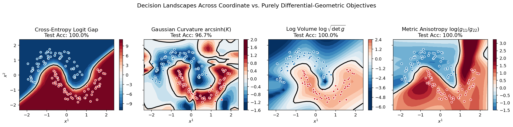
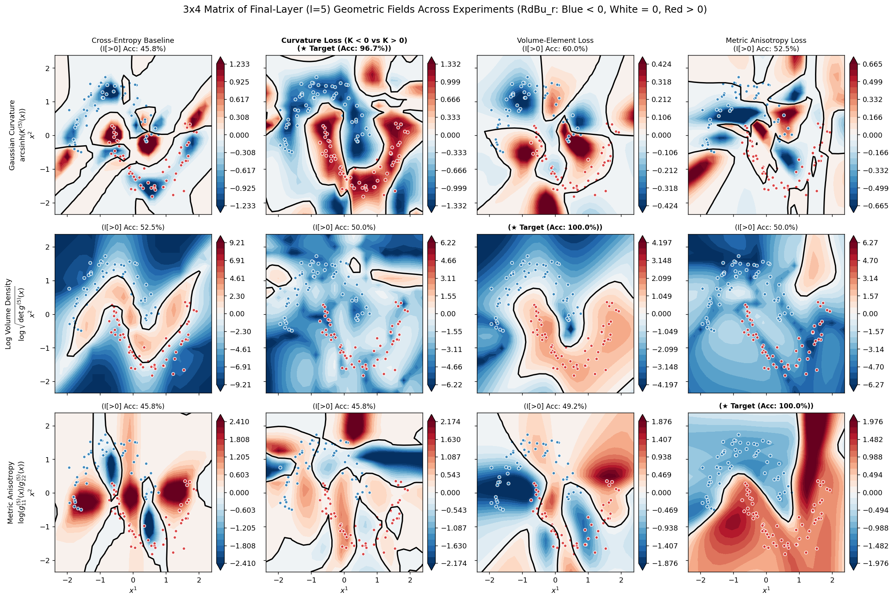
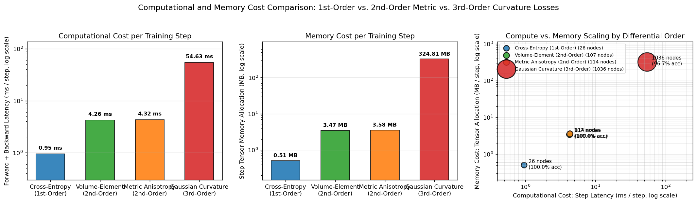

# Differential Geometry of Deep Learning: Parameter & Representation Manifolds

This project investigates the differential geometric interplay between two fundamental manifolds in machine learning using a **`[2 -> 5 -> 10 -> 15 -> 10 -> 2]` Multi-Layer Perceptron** ($P = 422$ parameters) on the 2D `sklearn.datasets.make_moons` benchmark:

1. **The Parameter Manifold ($\Theta \subset \mathbb{R}^{422}$)**: Endowed with the $422 \times 422$ Fisher Information Metric $F_{\mu\nu}(\theta)$ and Generalized Gauss-Newton pullback metric $G^\Theta_{\mu\nu}(\theta)$.
2. **The Data / Representation Manifolds ($\{\mathcal{M}_\ell\}_{\ell=0}^5$)**: The sequence of immersed 2D surfaces $\Phi^{(\ell)}_\theta(\mathbb{R}^2) \subset \mathbb{R}^{d_\ell}$ endowed with layerwise $2 \times 2$ pullback metric tensors $g^{(\ell)}_{ij}(x; \theta)$, Riemannian volume forms $\sqrt{\det g^{(\ell)}(x; \theta)}$, Levi-Civita Christoffel symbols $\Gamma^{(\ell)k}_{ij}(x; \theta)$, and intrinsic Gaussian curvature $K^{(\ell)}(x; \theta) = R^{(\ell)}_{1212} / \det g^{(\ell)}$.

---

## Core Research Objectives

1. **Layerwise Metric Tensor & Curvature Evolution**:
   Track how dimensional expansion ($2 \to 5 \to 10 \to 15$, immersion) and dimensional contraction ($15 \to 10 \to 2$, submersion) warp the pullback metric $g^{(\ell)}_{ij}(x)$ and Gaussian curvature $K^{(\ell)}(x)$ across layers and training epochs—testing decision-boundary volume magnification ([Zavatone-Veth et al., 2023](https://arxiv.org/abs/2301.11375)), singular foliation compression ([Benfenati & Marta, 2023](https://arxiv.org/abs/2201.09656)), and discrete Ricci flow smoothing ([Baptista et al., 2024](https://arxiv.org/abs/2404.14265); [Brandon et al., 2025](https://arxiv.org/abs/2512.00196)).
2. **Parameter–Data Manifold Duality & Metric Flows**:
   Quantify the spectral coupling between the $422 \times 422$ Parameter Fisher Information Matrix $F_{\mu\nu}(\theta)$ and the $2 \times 2$ Data Information Matrix $\mathrm{DIM}_{ij}(x; \theta)$ ([Tron et al., 2024/2026](https://arxiv.org/abs/2409.07412)), showing how perturbations and Natural Gradient trajectories on $\Theta$ induce metric and curvature flows on $\mathcal{M}_\ell$ ([Halverson & Ruehle, 2023](https://arxiv.org/abs/2310.19870)).
3. **Purely Geometric Loss Functions for Classification**:
   Train the neural network **exclusively through differential-geometric invariants** of the output representation manifold—without cross-entropy, MSE, or coordinate-level logit targets:
   - **Gaussian Curvature Margin Loss ($K < 0$ vs. $K > 0$)**: Drives Class $0$ into negative Gaussian curvature ($K(x) \le -\tau$, hyperbolic saddle geometry) and Class $1$ into positive Gaussian curvature ($K(x) \ge +\tau$, elliptic dome geometry) via 3rd-order automatic differentiation ($\nabla_\theta K(x; \theta)$).
   - **Riemannian Volume-Element Contrastive Loss ($\log\sqrt{\det g} < 0$ vs. $> 0$)**: Drives Class $0$ into locally contractive basins ($\sqrt{\det g(x)} < 1$) and Class $1$ into locally expansive regions ($\sqrt{\det g(x)} > 1$) separated by an equiareal decision boundary ($\det g(x) = 1$) via 2nd-order automatic differentiation.
   - **Directional Metric Anisotropy Loss ($\log(g_{11}/g_{22}) < 0$ vs. $> 0$)**: Separates classes by orthogonal metric stretching ratios.

---

## Main Results & Charts

### 1. Classification with Purely Differential-Geometric Losses
Training the `[2 -> 5 -> 10 -> 15 -> 10 -> 2]` MLP from scratch using purely geometric losses achieves **96.7% to 100.0% held-out test accuracy**, classifying test points strictly via geometric invariants ($\mathbb{I}[K(x) > 0]$, $\mathbb{I}[\log\sqrt{\det g(x)} > 0]$, or $\mathbb{I}[\log(g_{11}/g_{22}) > 0]$):



---

### 2. $3 \times 4$ Cross-Evaluation Matrix of Final-Layer Geometric Fields Across Experiments
Evaluating all three geometric invariants at the final layer ($\ell = 5$)—**Gaussian Curvature** $\operatorname{arcsinh}(K^{(5)}(x))$, **Log Volume Density** $\log\sqrt{\det g^{(5)}(x)}$, and **Metric Anisotropy** $\log(g^{(5)}_{11}(x)/g^{(5)}_{22}(x))$—across all four trained networks (`RdBu_r` centered at $0.0 = \text{white}$) reveals how each geometric loss selectively sculpts its target geometric field to separate Class $0$ (blue, $< 0$) from Class $1$ (red, $> 0$) along the zero contour (black):



| Layer $\ell$ (CE Baseline) | Transformation | Width $d_\ell$ | Median Volume $\sqrt{\det g^{(\ell)}}$ | Max Volume $\sqrt{\det g^{(\ell)}}$ | Median Anisotropy $\lambda_1 / \lambda_2$ |
| :---: | :--- | :---: | :---: | :---: | :---: |
| $\ell = 1$ | $2 \to 5$ (Expansion) | $5$ | `0.2651` | `1.2096` | `4.15` |
| $\ell = 2$ | $5 \to 10$ (Expansion) | $10$ | `0.3057` | `4.6523` | `10.43` |
| $\ell = 3$ | $10 \to 15$ (Max Expansion) | $15$ | `0.5322` | `17.9995` | `17.14` |
| $\ell = 4$ | $15 \to 10$ (Contraction) | $10$ | `0.1614` | `43.1118` | `146.20` |
| $\ell = 5$ | $10 \to 2$ (Output Projection) | $2$ | `0.1129` | `40.6741` | `15,385.30` |

---

### 3. Computational & Memory Cost by Differential Order
First-order metric invariants (**Volume-Element** $\sqrt{\det g}$ and **Metric Anisotropy** $g_{11}/g_{22}$) require only **2nd-order autodiff** ($\nabla_\theta J$) and are **$\sim 13\times$ faster** and use **$\sim 93.6\times$ less memory** than 2nd-order curvature $K(x)$ (which requires **3rd-order autodiff** $\nabla_\theta \partial_x^2 g_{ij}$):



| Training Objective | Decision Rule | Differential Order (wrt $\theta$) | Step Latency (`ms/step`) | Step Memory (`MB/step`) | Autograd Graph Nodes | Held-Out Test Accuracy |
| :--- | :--- | :---: | :---: | :---: | :---: | :---: |
| **1. Cross-Entropy Baseline** | $z_1(x) > z_0(x)$ | **1st-Order** ($\nabla_\theta z$) | `0.95 ms` | `0.51 MB` | `26` | **`100.00%`** |
| **2. Volume-Element Loss** | $\log\sqrt{\det g^{(5)}(x)} > 0$ | **2nd-Order** ($\nabla_\theta \partial_x z$) | `4.26 ms` | `3.47 MB` | `107` | **`100.00%`** |
| **3. Metric Anisotropy Loss** | $\log(g^{(5)}_{11} / g^{(5)}_{22}) > 0$ | **2nd-Order** ($\nabla_\theta \partial_x z$) | `4.32 ms` | `3.58 MB` | `114` | **`100.00%`** |
| **4. Gaussian Curvature Loss** | $K^{(5)}(x) > 0$ | **3rd-Order** ($\nabla_\theta \partial_x^2 g_{ij}$) | `54.63 ms` | `324.81 MB` | `1,036` | **`96.67%`** |

---

## Repository File Structure

```text
diffgeom/
├── README.md                                                 # Project summary, key results charts, and layout
├── spec.md                                                   # Mathematical formulation, literature review & experiment plan
├── src/
│   ├── __init__.py                                           # Package exports
│   └── geometry.py                                           # Composable torch.func differential geometry operators & losses
├── notebooks/
│   ├── 01_baseline_and_pullback_metrics.ipynb                # Layerwise pullback metrics, volume elements & Tissot ellipses
│   ├── 02_layerwise_curvature_evolution.ipynb                # Christoffel symbols, Riemann curvature & 2D-to-2D flatness analysis
│   ├── 03_parameter_data_manifold_duality.ipynb              # 422x422 Parameter FIM vs. 2x2 Data Information Matrix & Natural GD
│   ├── 04_purely_geometric_curvature_losses.ipynb            # End-to-end 3rd-order autodiff training with K < 0 vs. K > 0
│   └── 05_geometric_loss_ablations_and_synthesis.ipynb       # Comparison of curvature, volume & anisotropy losses + compute/memory costs
├── scripts/
│   ├── nb_executor.py                                        # Headless notebook builder & executor with inline PNG capture
│   └── build_all_notebooks.py                                # Rebuilds and executes all 5 notebooks end-to-end
└── assets/
    ├── decision_landscapes.png                               # 4-panel comparison of learned geometric decision boundaries
    ├── geometric_fields_matrix_3x4.png                       # 3x4 matrix of final-layer curvature, log volume & anisotropy across experiments
    └── compute_memory_benchmark.png                          # 3-panel latency, memory, and autograd node scaling chart
```

---

## Reproducing the Notebooks

All notebooks are pre-executed with embedded outputs and configured for the `lunarpoles` PyTorch kernel (`/opt/conda/envs/lunarpoles/bin/python`). To regenerate and execute all five notebooks from scratch:

```bash
/opt/conda/envs/lunarpoles/bin/python scripts/build_all_notebooks.py
```
